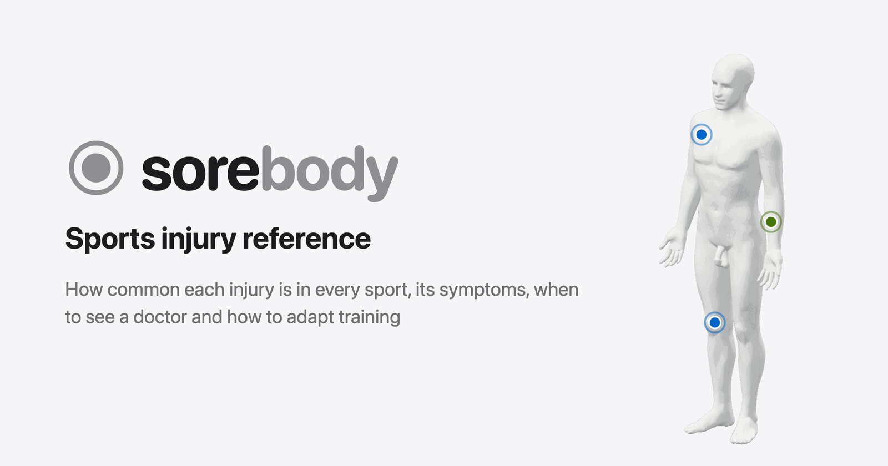

<p align="center">
	
	<a href="README.ru.md"></a>
</p>

<p align="center">
	<a href="https://sorebody.aimuzov.online"></a>
</p>

<p align="center">
	<a href="https://github.com/aimuzov/sorebody/actions/workflows/deploy.yml"></a>
	<a href="https://sorebody.aimuzov.online"></a>
	<a href="package.json"></a>
	<a href="https://astro.build"></a>
	<a href="https://svelte.dev"></a>
	<a href="LICENSE"></a>
</p>

<h3 align="center">Sorebody, a sports pain reference: how common each kind of pain is in CrossFit, padel, football, running, basketball and hiking, its symptoms, when to see a doctor and how to adapt training, with links to the research.</h3>

<!-- Uncomment once the screenshots are in .github/assets.
<table>
	<tr>
		<td width="50%" align="center"><br><b>Home</b> for visitors</td>
		<td width="50%" align="center"><br><b>Screen</b> what it shows</td>
	</tr>
</table>
-->

<p>Lives at <a href="https://sorebody.aimuzov.online">sorebody.aimuzov.online</a>. A static <a href="https://astro.build">Astro</a> site, interactive islands are written in <a href="https://svelte.dev">Svelte</a>.</p>

The site is in Russian, so the names below are translated.

## What's inside

- **Sport home** (`/` for CrossFit, `/<sport>/`): a 3D body with pain zones, search and filters. The sport is switched from a list in the heading, each one has its own color ([`src/frontend/data/sports.ts`](src/frontend/data/sports.ts)).
- **Article** (`/<sport>/<injury>/`): the shared part of an injury plus the take for the sport. The shared part on its own is at `/injuries/<injury>/`.
- **About**, **What's new** and **404** have no sport, their accent is graphite.
- **Brand**: the "pain point" mark in [`logo.svelte`](src/frontend/components/logo.svelte); the favicon, icons, OG image and README banner are rendered by [`scripts/brand/render.mjs`](scripts/brand/render.mjs). The name and descriptor live in [`site.ts`](src/frontend/data/site.ts).
- **Public MCP** at `/mcp` (Streamable HTTP, no sessions, read-only): search over the articles, an article by sections, red flags, the catalog. The base is `/knowledge.json`, which the site build emits; the server is [`src/backend/mcp.ts`](src/backend/mcp.ts).
- **Footer**: the author credit from [infra-site-kit](https://github.com/aimuzov/infra-site-kit) with a link to the source code, `repo` in [`site.ts`](src/frontend/data/site.ts).

## How it is built

Everything lives in `src/`:

- [`src/frontend`](src/frontend): the Astro site, it is the `srcDir` in `astro.config.mjs`. Imports go through `#frontend/*`.
- [`src/backend`](src/backend): the API next to the site, the way shkatova-psychologist and prestige-logist do it: plain Node running TypeScript, no build, imports through `#backend/*`. Code both sides need is in [`src/shared`](src/shared) (`#shared/*`), the image is [`deploy/backend.Dockerfile`](deploy/backend.Dockerfile), the `api` service in `deploy/docker-compose.yml`. The site never imports from `src/backend`.

Everything about the server is in [`deploy`](deploy): the Dockerfile, compose and nginx. The deploy script is shared by all sites and lives in [infra-server](https://github.com/aimuzov/infra-server).

Every file, components included, is named in kebab-case: `base.astro`, `section-photo.astro`. The name used in markup comes from the import (`import Base from '#frontend/layouts/base.astro'`), and the `unicorn/filename-case` rule in oxlint keeps file names in line.

## Running

Stack and layout follow [infra-site-template](https://github.com/aimuzov/infra-site-template): Astro + Svelte 5, Prettier, oxlint, stylelint (BEM), `node --test` for unit tests, Playwright for e2e. The Prettier, stylelint, oxlint and Playwright configs and the CI steps come from [infra-site-kit](https://github.com/aimuzov/infra-site-kit). Node comes from [`mise.toml`](mise.toml), the same version is pinned in `package.json` and [`deploy/frontend.Dockerfile`](deploy/frontend.Dockerfile).

```sh
cp .env.example .env   # may stay empty, but the file has to exist
npm ci
npm run dev
```

Before committing, the same checks as in CI:

```sh
npm run format:check && npm run lint:js && npm run lint:css && npm run check && npm test && npm run build
```

E2E tests in [`e2e`](e2e) build the site and open it in Chromium: every sitemap page answers without console errors and passes axe. CI runs them after the checks. The browser is installed once with `npx playwright install chromium`.

```sh
npm run test:e2e
```

The API and MCP run on Node without a build, the base comes from `dist/knowledge.json`, so build the site first. `npm run api` serves `/mcp` on port 8787; `npm run mcp:stdio` is the same server over stdio, for Claude Desktop or `npx @modelcontextprotocol/inspector`.

```sh
npm run build && npm run api
```

## Mobile

Safari on iPhone zooms the page in when you tap a field whose text is under 16px, and never zooms back out. So `input`, `textarea` and `select` on touch screens (`@media (--touch)`) get at least `1rem`: the base rule lives in [`global.css`](src/frontend/styles/global.css), and a component that sets its own `font-size` on a field has to repeat it.

Zoom as a whole is not turned off with `maximum-scale=1` or `user-scalable=no` in the viewport: that leaves people with poor eyesight no way to enlarge small text.

## Content Security Policy

The build puts a CSP with hashes of Astro's scripts and styles into every page (the `security.csp` option in `astro.config.mjs`). `npm run dev` has no policy, so violations only show up after `npm run build && npm run preview` and in production.

- No `style=""` attributes or handlers like `onclick`: styles go through classes and rules in `<style>`, handlers live in `<script>`.
- An external script, image or request (a widget, a map, a font from a CDN) has to be allowed in `security.csp` first. Out of the box it allows only the site itself.
- After such changes, check the browser console in `npm run preview`: the browser reports everything it blocks there.

## Deployment

The projects server from [infra-server](https://github.com/aimuzov/infra-server): merging the release PR that release-please keeps open runs `deploy.yml`, which runs the checks and logs in over SSH. The steps of both come from [infra-site-kit](https://github.com/aimuzov/infra-site-kit), which also holds the server address and its `known_hosts` line. There the key runs the shared [`deploy/site.sh`](https://github.com/aimuzov/infra-server/blob/main/deploy/site.sh) of infra-server, which checks out the release tag and rebuilds the `sorebody` container (nginx with the static site) from [`deploy/docker-compose.yml`](deploy/docker-compose.yml). The build runs in a systemd unit, so a dropped SSH connection does not cut it short. The domain and TLS are handled by the shared Caddy. `.env` (build variables) and `api.env` (the OpenRouter key and settings of the site chat, see `api.env.example`) live on the server in `/srv/sorebody`.

The deploy job runs only when the repository variable `DEPLOY_ENABLED` is `true`, and the SSH key is the `DEPLOY_SSH_KEY` secret. Until the server is set up, a release only runs the checks.

To roll back fast, run Deploy by hand with the previous tag: `gh workflow run deploy.yml -f tag=v1.2.3`. A fix of the bad commit goes out through the release PR like any change.

### What's new page

`CHANGELOG.md` is for developers and release-please writes it. The [/changelog](src/frontend/pages/changelog.astro) page tells readers the same story in plain Russian, and its entries live in [`src/frontend/data/changelog.ts`](src/frontend/data/changelog.ts). Before merging a release PR, add an entry at the top: the version and date from its `CHANGELOG.md`, a short title and what a reader will notice. Leave out CI, refactoring and dependencies. A link inside an item is written `[text](/path)`, and a test checks that every link leads to an existing page. Another test fails the release PR until its version has an entry.

## License

The code is licensed under [MIT](LICENSE). Site content (texts, images, names and contacts) is not covered by it: all rights reserved.
